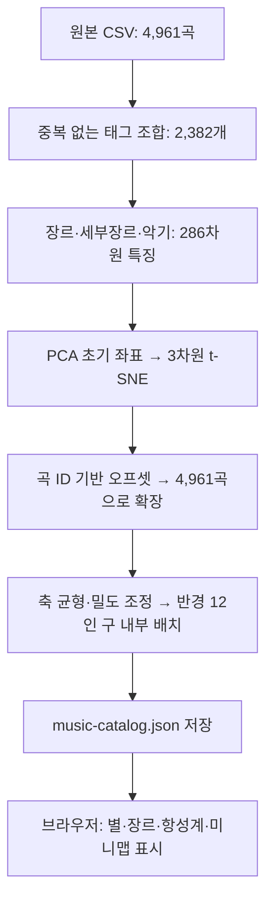

# 데이터·t-SNE·탐색 로직

[README로 돌아가기](../README.md)

이 문서는 현재 코드와 배포용 카탈로그를 기준으로 작성했습니다. 데이터 준비는 [prepare_data.py](../frontend/scripts/prepare_data.py), 브라우저의 모델은 [catalog.ts](../frontend/src/domain/catalog.ts)가 담당합니다.

## 1. 전체 흐름



- **t-SNE 계산:** 태그가 비슷한 프로필의 이웃 관계를 3차원으로 표현합니다.
- **구형 후처리:** 빈 영역을 줄이고 둥근 음악 우주를 만드는 표시용 변환입니다.
- **화면 조작:** 저장된 좌표를 읽어 카메라·색·밝기·라벨을 바꿉니다. 브라우저에서 t-SNE를 다시 계산하지 않습니다.
- 장르 분류는 CSV에 있는 값을 사용합니다. K-means나 DBSCAN으로 장르를 새로 찾는 구조는 아닙니다.

## 2. 입력 데이터와 전처리

원본은 루트의 [mtg_jamendo_genre_instrument.csv](../mtg_jamendo_genre_instrument.csv)입니다. 전처리 과정에서 원본을 수정하거나 이동하지 않습니다.

| 항목 | 현재 값 | 처리 |
| --- | --- | --- |
| 곡 | 4,961개 | `TRACK_ID`를 문자열로 보존; 앞자리 0 유지 |
| 대장르 | 15개 | `/`가 들어간 이름도 하나의 장르 |
| 세부장르 | 146개 | `\|`로 분리, 앞뒤 공백·중복 제거, 정렬 |
| 악기 | 125개 | 세부장르와 같은 태그 정리 적용 |
| 프로필 | 2,382개 | `(대장르, 정렬된 세부장르 목록, 정렬된 악기 목록)`의 고유 조합 |
| 특징 차원 | 286개 | 대장르 15 + 세부장르 146 + 악기 125 |

- 같은 장르·세부장르여도 악기 조합이 다르면 별도 프로필입니다.
- 같은 프로필은 t-SNE 입력에 한 번만 들어갑니다. 해당 프로필에 곡이 많다고 입력 행을 반복하거나 빈도 가중치를 주지는 않습니다.
- 곡명·아티스트·재생시간·MP3 경로는 메타데이터로 보존하며 특징 벡터에 넣지 않습니다.
- 실제 오디오, BPM, 음량, 주파수 특징은 입력에 없습니다.

## 3. 특징 벡터와 가중치

구현: [profile_features()](../frontend/scripts/prepare_data.py).

| 특징 묶음 | 표현 | cosine 유사도 기여 비중 |
| --- | --- | --- |
| 대장르 | one-hot | 0.15 |
| 세부장르 | multi-hot | 0.30 |
| 악기 | multi-hot | 0.55 |

한 묶음의 가중치가 `w`이고 활성 태그가 `k`개이면, 활성 항목마다 다음 값을 넣습니다. 비활성 항목은 0입니다.

```text
활성 태그 값 = sqrt(w / k)
```

- 각 묶음의 L2 norm은 `sqrt(w)`가 됩니다.
- 세 묶음을 이어 붙이면 현재 데이터에서 벡터 전체의 L2 norm은 1입니다.
- 태그가 많아져도 해당 묶음의 전체 비중은 늘어나지 않습니다.
- 15%·30%·55%는 코드에 정한 설계 값입니다. 사용자 행동에서 학습하거나 최적값을 추정한 결과는 아닙니다.

두 프로필의 대장르를 `G`, 세부장르 집합을 `S`, 악기 집합을 `I`라고 하면 입력 특징의 유사도를 다음처럼 읽을 수 있습니다.

```text
similarity(a, b)
  = 0.15 × [G_a와 G_b가 같으면 1, 다르면 0]
  + 0.30 × |S_a ∩ S_b| / sqrt(|S_a| × |S_b|)
  + 0.55 × |I_a ∩ I_b| / sqrt(|I_a| × |I_b|)

cosine distance = 1 - similarity
```

예를 들어 `Electronic / House / Piano`와 `Pop / Indie Pop / Piano`라는 가상 프로필은 장르·세부장르가 달라도 악기를 공유하므로 유사도가 `0.55`입니다. 같은 입력에서 두 번째 프로필의 악기를 `Guitar`로 바꾸면 유사도는 `0`이 됩니다.

이 비중은 **t-SNE 입력 특징의 유사도**에 적용됩니다. 최종 화면에서 거리가 이 비율대로 표현된다는 뜻은 아닙니다.

## 4. t-SNE의 실제 실행 설정

사용 라이브러리는 [requirements.txt](../frontend/scripts/requirements.txt)에 지정된 `numpy==2.2.6`, `scikit-learn==1.7.2`입니다. 구형 후처리에는 scikit-learn의 의존성으로 설치되는 SciPy도 사용합니다.

먼저 286차원 특징에서 PCA 초기 좌표를 직접 만듭니다.

```python
initial = PCA(n_components=3, svd_solver="full").fit_transform(feature).astype(np.float32)
initial *= 1e-4 / initial[:, 0].std()

xyz = TSNE(
    n_components=3,
    metric="cosine",
    perplexity=40,
    random_state=42,
    init=initial,
    learning_rate="auto",
    max_iter=1000,
    n_jobs=1,
).fit_transform(feature)
```

| 설정 | 현재 값 | 의미 |
| --- | --- | --- |
| 입력 행렬 | `2382 × 286` | 곡 전체가 아닌 고유 태그 프로필 |
| 출력 차원 | `3` | X·Y·Z 좌표 |
| 거리 | `cosine` | 정규화한 태그 특징을 비교 |
| perplexity | `40` | 이웃 관계를 계산하는 범위에 영향을 주는 값; 군집 개수는 아님 |
| 초기화 | 직접 만든 PCA 배열 | 첫 번째 축의 표준편차가 `1e-4`가 되도록 배열 전체를 같은 배율로 축소 |
| 난수 시드 | `42` | `random_state` |
| 학습률 | `auto` | 현재 입력에서는 `50` |
| 최대 반복 | `1000` | 조기 종료될 수 있으므로 항상 정확히 1,000회 실행되는 것은 아님 |
| `n_jobs` | `1` | 코드에서 명시한 이웃 계산 설정 |

나머지는 scikit-learn 1.7.2의 기본값입니다. 주요 값은 `method="barnes_hut"`, `angle=0.5`, `early_exaggeration=12.0`, `n_iter_without_progress=300`, `min_grad_norm=1e-7`입니다. `auto` 학습률은 `max(N / early_exaggeration / 4, 50)`이므로 현재 `N=2382`에서 50입니다. [공식 TSNE 문서](https://scikit-learn.org/1.7/modules/generated/sklearn.manifold.TSNE.html)

## 5. t-SNE 좌표를 둥근 우주로 바꾸는 과정

구현: [build()와 spherical_layout()](../frontend/scripts/prepare_data.py).

### 5.1 곡별 좌표로 확장

- 각 곡은 자신의 프로필에 해당하는 t-SNE 좌표를 가져옵니다.
- `random.Random(int(TRACK_ID))`로 곡별 난수를 고정합니다.
- X·Y·Z 각각에 `[-0.35, 0.35]`의 작은 오프셋을 더해 같은 프로필의 곡들을 분리합니다.
- 이 오프셋은 **구형 변환 전 좌표의 단위**이며, 최종 화면에서 반경 0.35를 보장하는 값은 아닙니다.

### 5.2 축 균형과 첫 반경 배치

1. 4,961개 점의 평균을 빼 중심을 맞춥니다.
2. 공분산 행렬을 고유분해하고 whitening 변환으로 세 축의 분산을 균형 있게 조정합니다. 고유값의 하한은 `1e-8`입니다.
3. 원점에서의 거리 순위를 구의 부피에 맞는 반경으로 바꿉니다.

```text
r = 12 × ((rank + 0.5) / N)^(1/3)

rank: 0부터 시작하는 거리 순위
N: 4,961곡
```

모든 점을 같은 반경의 껍데기에 붙이지 않고 구 내부를 채웁니다.

### 5.3 빈 영역을 줄이는 밀도 조정

- `Halton(3, scramble=True, seed=42)`으로 구 내부를 채우는 기준 분포를 만듭니다.
- `np.random.default_rng(42)`로 192개 방향을 생성하고 각 방향을 단위 벡터로 정규화합니다.
- 각 방향에서 실제 점과 기준 점의 투영값을 각각 정렬합니다.
- 같은 순위의 투영값 차이에 `0.6`을 곱해 실제 점을 그 방향으로 이동합니다.
- 192개 방향을 처리한 뒤 거리 순위에 위 반경 공식을 다시 적용합니다.

기준 분포는 배치를 조정하는 데만 사용합니다. 음악 데이터나 추가 별로 저장하지 않으며, 최종 곡의 점은 계속 4,961개입니다.

### 5.4 저장과 그룹 중심

- 최종 곡 좌표는 소수점 5자리로 반올림합니다.
- 대장르·세부장르의 기준점은 소속 곡의 최종 X·Y·Z 평균입니다.
- 여러 세부장르에 속하는 곡은 각 세부장르의 평균 계산에 포함됩니다.
- [music-catalog.json](../frontend/public/data/music-catalog.json)에는 최종 구형 좌표만 저장합니다. 후처리 전 t-SNE 좌표는 별도로 저장하지 않습니다.
- 브라우저의 [spacePosition()](../frontend/src/scene/space.ts)는 저장된 XYZ를 그대로 사용합니다. 장르 ID에 따른 임의 Z축을 추가하지 않습니다.

**해석 범위:** t-SNE는 전체 거리 보존을 보장하지 않고, 구형 후처리도 거리·밀도·방향을 바꿉니다. 가까운 별은 태그 관계를 살펴보는 단서이며, 화면의 간격을 실제 음향 차이의 측정값으로 읽으면 안 됩니다. [공식 manifold 설명](https://scikit-learn.org/1.7/modules/manifold.html#t-sne)

## 6. 선·별빛·호버의 의미

### 고정 연결선

생성 기준은 [prepare_data.py](../frontend/scripts/prepare_data.py), 표시는 [ConstellationLinks](../frontend/src/scene/ParticleField.tsx)가 담당합니다.

- 최종 구형 좌표에서 곡마다 주변 10개 이웃을 후보로 조회합니다.
- 후보 중 아래 조건을 모두 만족하는 쌍을 남깁니다.
  - 최종 좌표의 거리: `0.6 < 거리 < 2.8`.
  - 입력 특징 벡터의 유사도: `similarity > 0.65`.
  - 공통 악기가 하나 이상 있음.
- 유사도 내림차순으로 선택하며, 한 곡은 최대 한 연결선에만 사용합니다.
- 선택된 선들의 중점 사이 거리가 `1.8` 미만이면 건너뛰어 특정 위치에 선이 몰리지 않게 합니다.
- 최대 40쌍을 저장합니다. 현재 카탈로그에는 40쌍이 있습니다.

이 선은 전체 유사도 그래프나 음악 장르 사이의 확정 관계가 아니라, 조건을 만족하는 일부 곡 쌍의 표시입니다. 배경에서 움직이는 짧은 꼬리별은 장식이고, 이름과 기준점을 잇는 선은 라벨 위치 안내입니다.

### 별빛과 실제 곡 선택

구현: [ParticleField](../frontend/src/scene/ParticleField.tsx), [hoveredGenre()](../frontend/src/scene/hover.ts), [Scene](../frontend/src/scene/Scene.tsx).

- 별 하나는 실제 곡 하나이며, 별의 장르색은 해당 곡의 `genreId`로 결정됩니다.
- 작은 점의 가장자리를 부드럽게 감쇠하고, 곡 ID로 고정한 시드에 따라 밝기를 천천히 변화시킵니다.
- 시간 값은 매 프레임 실제 렌더링 중인 `ShaderMaterial.uniforms.uTime`에 전달합니다.
- 호버는 포인터가 움직였을 때 최대 약 80ms 간격으로 조회합니다. 광선 주변 반경 `0.32`에 들어오는 실제 별들의 장르를 투표합니다.
- 홈의 별 클릭도 같은 반경을 사용하고, 현재 강조된 장르를 반영해 투표합니다. 이름 위로 이동하지 않아도 호버한 별 주변을 클릭해 해당 장르로 들어갈 수 있습니다. 드래그와 이동 중 클릭은 제외합니다.
- 포인터 광선에 가깝고 카메라 앞쪽에 있는 별에 더 높은 가중치를 줍니다. 현재 장르의 점수가 최고 점수의 80% 이상이면 선택을 유지합니다.
- 강조 시작은 약 100ms, 해제는 약 240ms의 지연을 두고 색을 부드럽게 전환합니다.
- 해당 장르의 곡만 색이 활성화되며, 홈의 이름은 호버·키보드 포커스 시에만 표시됩니다.
- 강조된 별은 중심 크기를 유지하면서 주변 광채 범위를 최대 3.5배로 넓히고, 어두워지는 정도를 줄여 장르색을 더 잘 드러냅니다. 광채는 실제 소속 별마다 적용하는 표시 효과이며, 별을 추가하거나 별 사이에 새로운 관계를 만들지 않습니다.
- 홈은 천천히 자동 회전하고 호버 중에는 멈춥니다. 모션 감소 설정에서는 자동 회전과 밝기 애니메이션을 끕니다.

## 7. 방문 누적과 표시 변화

구현: [reducer.ts](../frontend/src/state/reducer.ts), [visits.ts](../frontend/src/domain/visits.ts), [VisitPanel](../frontend/src/components/VisitPanel.tsx).

| 상태 | 역할 |
| --- | --- |
| `transition` / `arrivedTransition` | 현재 이동과 완료된 이동의 번호; 취소·중복 도착 방지 |
| `arrivedGenreId` | 마지막으로 실제 도착한 장르; 같은 장르 안의 중복 집계 방지 |
| `genreVisits` | 대장르별 방문 누적 |
| `visits` / `history` | 세부장르별 방문 수와 도착 순서; 미니맵 경로에 사용 |

- 다른 장르나 전체 지도에서 해당 장르에 **실제 도착했을 때** 대장르 방문을 1회 추가합니다.
- 추천으로 세부장르에 바로 들어가도 부모 장르 방문을 기록합니다.
- 같은 장르 안의 세부장르 이동과 부모 화면 복귀는 대장르 방문을 추가하지 않습니다.
- 곡 선택·호버·취소된 이동·같은 완료 이벤트의 재호출도 추가하지 않습니다.

```text
누적 색 비중 = min(대장르 방문 수, 5) / 5
누적 밝기 배수 = 1 + min(대장르 방문 수, 10) × 0.12
최종 색 비중 = max(호버 강조 비중, 누적 색 비중)
```

- 1회: 색 20%, 밝기 계수 1.12배.
- 5회: 호버와 같은 장르색 완성, 밝기 계수 1.6배.
- 10회 이상: 같은 장르색 유지, 밝기 계수 최대 2.2배.
- 방문 횟수 자체에는 상한을 두지 않습니다.
- 밝기 배수는 반짝임과 함께 사용하는 표시 계수입니다. 매 순간의 픽셀 밝기가 정확히 그 배수가 된다는 뜻은 아닙니다.
- 방문으로 좌표나 별 크기를 바꾸지 않습니다. 표시 계수만 갱신하므로 별 geometry를 재생성하지 않습니다.
- 현재 기록은 메모리에 유지합니다. 발표·탐색 전환 시 유지되고 새로고침하면 초기화됩니다.

### 방문 기록 그래프

- `genreVisits > 0`인 장르와 `visits > 0`인 세부장르만 방문 기록 패널에 표시합니다. 각각 횟수 내림차순, 동점은 이름순입니다.
- 장르의 막대 비중은 `해당 genreVisits / 전체 genreVisits 합계`입니다.
- 세부장르의 막대 비중은 `해당 visits / 같은 부모 장르에 속한 visits 합계`입니다. 대장르 진입과 그 안의 세부장르 탐색은 별도 집계하므로 두 분모를 섞지 않습니다.
- 방문한 세부장르가 없는 장르는 하위 목록을 생략합니다. 기록이 전혀 없으면 짧은 빈 상태만 표시합니다.
- 상단에는 전체 영역의 탐색률과 격자 차트를 하나 표시합니다. 탐색률은 `(방문한 대장르 수 + 방문한 세부장르 수) / (전체 대장르 수 + 전체 세부장르 수) × 100`이며 현재 분모는 `15 + 146 = 161`입니다. 같은 영역을 다시 방문해도 탐색률은 증가하지 않습니다.
- 격자는 영역마다 한 칸이며, 방문한 칸만 부모 장르색으로 채웁니다. 아래 상세 목록에는 이름·횟수·비율·막대만 표시합니다. 세부장르 개수·집계 기준·초기화 안내 등의 설명은 이 문서에서 관리합니다.
- 색 누적은 회색 별이 고유 장르색으로 물드는 비중(`colorMix`), 밝기 누적은 별빛 세기 배수(`brightness`)입니다. 색·밝기 누적 수치는 방문 기록 패널에서 표시하지 않습니다. 실제 별의 색·밝기 누적 계산과 새로고침 시 초기화하는 정책은 유지합니다.

## 8. 추천·세부장르 별·음악 막대

### 장르 × 세션 범주 모델

구현: [category.ts](../frontend/src/domain/category.ts), [recommendations.ts](../frontend/src/domain/recommendations.ts), 모델 [category-model.json](../frontend/public/data/category-model.json). 모델은 [build_category_model.py](../frontend/scripts/build_category_model.py)가 루트의 세 CSV로 만듭니다(표준 라이브러리만 사용).

| 입력 | 내용 |
| --- | --- |
| `mtg_genre_category.csv` | 기존 CSV와 모든 열이 같고 `category` 열(예: `rock_drums\|rock_bass`)이 추가된 4,961곡. 엑셀 저장으로 빠진 `TRACK_ID` 앞자리 0은 7자리로 복원 |
| `mtg_category_definition.csv` | 장르 15 × 세션 16 중 실제로 존재하는 231개 범주. `family_rate`(장르 안 출현율), `lift`(전체 대비 특이도), 소속 악기 |
| `genre_color.csv` | 장르 대표색. 스크립트가 `music-catalog.json`의 장르색도 이 값으로 바꿉니다(좌표는 그대로) |

| 모델 항목 | 내용 |
| --- | --- |
| 세션 16종 (열·무늬) | 드럼·비트·퍼커션·베이스·일렉 기타·어쿠스틱 기타·피아노·건반·신스·현악·금관·목관·말렛·리드·민속 악기·보컬. 리듬 → 저음 → 화성 → 선율 → 음색 → 목소리 순 |
| 장르 15종 (행·색) | `genres[].rates` = `family_rate`, `lifts` = `lift` |
| 세부장르 프로필 `q_S` | 소속 곡 중 각 세션을 쓰는 곡의 비율 |
| 곡 마스크 | 곡의 `category`가 가리키는 세션을 비트로 표시. 곡의 범주는 항상 자기 장르 행 |

### 선택표

구현: [StageConsole.tsx](../frontend/src/components/StageConsole.tsx), [SessionGlyph.tsx](../frontend/src/components/SessionGlyph.tsx).

- 기본 입력은 **두 단계 칩**입니다. ① 장르 칩과 ② 악기(세션) 칩을 고르면, 선택은 두 칩 집합의 교차 칸(존재하는 칸만)이 됩니다. 칩을 켜면 그 줄에서 상대 차원의 켜진 칩과 만나는 칸을 더하고, 끄면 그 행·열 전체를 뺍니다(`pickChip`). 표에서 직접 고른 칸은 유지되며, 칩에는 표에서 고른 칸 수가 작은 배지로 보입니다.
- 순서는 칩 → 세부장르 추천 → 접힌 "장르 × 악기 표"입니다. 표는 칸 단위로 세밀하게 고를 때만 펼칩니다.
- 행은 장르(장르색), 열은 세션(무늬 + 짧은 악기 이름)입니다. 231칸 각각은 **장르색으로 그린 세션 무늬**이며, 없는 9칸은 점으로 남깁니다.
- 칸 배경은 히트맵입니다. 장르색을 `6 + 58 × min(1, family_rate / 0.7)`% 섞어 칠하므로, 진한 칸일수록 그 장르 곡에서 그 악기가 자주 쓰입니다. 표 아래에 범례를 둡니다. 고른 칸은 흰 테두리로 표시합니다.
- 표 오른쪽 위의 **히트맵 / 버블** 전환으로 같은 표를 버블 차트로 볼 수 있습니다. 원 지름은 `18 + 82 × √family_rate`%(면적 ∝ 출현율), 진하기는 `0.22 + 0.78 × clamp((ln lift + 1) / 2)`(lift 0.37배 이하 흐림, 1배 중간, 2.7배 이상 가장 진함)입니다. 크고 진한 원이 그 장르를 대표하는 악기입니다.
- 칸을 누르면 담기고, 행·열 머리를 누르면 그 줄 전체를 담습니다(이미 전부 담겨 있으면 전부 뺍니다). 호버한 칸의 곡 수, 장르 곡 중 사용 비율, 전체 평균 대비 배수(lift), 악기를 표 아래에 표시합니다.
- 선택과 켜진 칩은 메모리에만 유지하며 새로고침하면 초기화됩니다. 비우기는 둘 다 비웁니다.

### 세부장르 점수

고른 칸 집합을 `C`, 칸 `c`의 장르·세션을 `g_c`, `s_c`라 하고 세부장르 `S`의 장르를 `G`라 합니다.

```text
q̃_S(s)  = λ·q_S(s) + (1 − λ)·rate_G(s),   λ = n_S / (n_S + 12)     (작은 세부장르는 장르 프로필에 기댐)
q̂_S(s)  = q̃_S(s) / max_s q̃_S(s)                                     (가장 전형적인 세션 = 1)
ρ(c)     = 1 (g_c = G) / 0.5 (다른 장르 행의 같은 세션)
w(s)     = max_{c: s_c = s} ρ(c),  고르지 않은 세션은 0
prec     = Σ_c q̂_S(s_c)·ρ(c) / |C|
recall   = Σ_s q̂_S(s)·w(s) / Σ_s q̂_S(s)
core(S)  = 2·prec·recall / (prec + recall)
size(S)  = log(n_S + 1) / log(n_max + 1)
focus(S) = 0.55 + 0.45 × (C 중 G 행에 있는 칸의 비율)
explore  = 1.06 (G의 genreVisits가 0) / 1.00
score(S) = min(1, (0.86·core + 0.14·size) × focus × explore)
```

- **색(장르)** 은 `focus`와 `ρ`로, **무늬(세션)** 는 `q̂`를 통한 prec·recall로 점수에 들어갑니다. 같은 무늬를 다른 색에서 고르면 절반만 인정합니다.
- 아무 칸도 고르지 않으면 추천은 비어 있습니다. 점수가 양수인 세부장르를 내림차순으로 정렬하고(동점은 모델 순서), 선택표 아래에 6개씩, 다이얼로그에 5개씩 보여줍니다. 점수는 0–100으로 반올림해 표시합니다.
- 세부장르 안의 "다음 추천" 카드는 현재 세부장르를 뺀 순위에서 장르별 최고 하나씩 최대 3개입니다. 추천을 눌러도 선택은 바뀌지 않습니다.

### 세부장르 안의 곡 순서

구현: [scoreSubgenreTracks()](../frontend/src/domain/category.ts), [scoredPlaylist()](../frontend/src/domain/catalog.ts).

```text
match_t   = F1(prec = Σ_{c: s_c ∈ T_t} ρ(c) / |C|,  recall = Σ_{s ∈ T_t} w(s) / |T_t|)      T_t = 곡의 세션 집합
typical_t = 곡 세션들의 q_S(s) / max q_S 평균                                             (세부장르다운 편성인가)
len_t     = 1 (2:30–5:00), 1:00 → 2:30과 5:00 → 9:00 구간은 선형, 그 밖은 0
base_t    = 0.74·match + 0.12·typical + 0.14·len        (칸을 골랐을 때)
          = 0.55·typical + 0.45·len                    (아무것도 고르지 않았을 때)
          + hash(곡 순번, 세부장르 순번, 31) × 0.008
목록      = 탐욕 선택: 매번 base_t − 0.18 × (이미 뽑힌 같은 아티스트 곡 수)가 가장 큰 곡
            (아티스트별 최고 곡만 겨루므로 최대 힙으로 O(n log 아티스트 수); 결과는 같은 선택 배열에 대해 재사용)
```

- 기존의 "아티스트 첫 곡 먼저, 나머지는 뒤로" 규칙을 **감점 방식**으로 바꿨습니다. 같은 아티스트의 두 번째 곡도 다른 곡보다 0.18 이상 잘 맞으면 앞에 설 수 있습니다.
- 길이 보정도 계단(+0.03/−0.04)에서 연속 함수로 바꾸고 비중을 키웠습니다.
- 플레이리스트에는 각 곡의 점수를 얇은 막대로 보여줍니다.

### 세부장르 별·곡 카드

구현: [MusicSystem](../frontend/src/scene/MusicSystem.tsx), [Scene.tsx](../frontend/src/scene/Scene.tsx).

- 세부장르에 도착하면 **소속 곡 전부**가 지도의 실제 좌표에 고정된 별로 나타납니다(공전 없음). 별 색은 장르색이며, 크기는 곡 점수에 비례합니다(0.20–0.36). 지도의 원래 점은 중복을 막기 위해 마스크로 숨깁니다.
- 호버하면 별이 18% 커집니다. 클릭하면 곡을 고르고 재생하며, 별 옆에 **곡 이름 / 아티스트 / 길이**만 담은 카드가 뜹니다(속성 이름 없음).
- 재생 중인 곡은 찾기 쉽도록 세 겹으로 강조합니다.
  - **별:** 천천히 도는 여덟 갈래 광채(가로세로 + 옅은 대각)가 생기고, 1.5초마다 번쩍(크기 +50%, 광채 강화) 빛난 뒤 잦아듭니다. 실시간 음량(RMS)에 맞춰 커졌다 작아집니다.
  - **비컨:** 번쩍임에 맞춰 별에서 고리가 퍼져 나갑니다. 카메라 거리에 비례해 크기를 정하므로 화면에서 늘 비슷한 크기입니다.
  - **성운:** 재생 중에는 그 별을 중심으로 장르색 성운이 연하게 깔립니다. 지름은 세부장르 곡 90%가 들어가는 반경의 약 3.2배(5–22)이고, 도메인 왜곡 fBm 노이즈로 천천히 흐르며 음량에 따라 살짝 짙어집니다. 파스텔 장르색은 채도를 높여 쓰고, 가장자리 쪽은 색상을 약간 돌린 어두운 톤으로 깊이를 줍니다. 곡을 바꾸면 성운이 새 별로 미끄러지듯 옮겨 가고, 멈추면 서서히 사라집니다.
  - 성운과 비컨은 포인터 판정에서 빠져 별 클릭을 가로채지 않습니다. 모션 감소 설정에서는 번쩍임·고리 확산·성운 흐름을 끄고 정지된 강조만 남깁니다.

### 음악 막대와 재생

- 곡을 선택하면 [jamendo.ts](../frontend/src/audio/jamendo.ts)가 Jamendo API(JSONP, 12초 제한)로 `TRACK_ID`의 음원 주소를 받아 재생합니다. 실패하면 `TRACK_ID` 기반 저장소 주소로 한 번 더 시도합니다. 나중에 누른 곡이 앞선 요청을 이기며, 세부장르를 벗어나면 재생을 멈춥니다.
- Jamendo 저장소는 CORS를 허용하므로 `<audio crossOrigin="anonymous">`를 `AnalyserNode`(FFT 2048)에 연결합니다. 음악 막대 40개는 매 프레임 스펙트럼을 저음→고음으로 나눈 값입니다([levels.ts](../frontend/src/audio/levels.ts)). 밴드는 이차 곡선으로 넓어지고 서로 FFT 칸을 공유하지 않으며, 밴드 값은 칸들의 전력 평균(dB)에 100 Hz 위 옥타브당 +2.5 dB의 고음 보정을 더한 것입니다.
- 높이는 **자동 이득**으로 정합니다. 바이트 스펙트럼은 −30 dB 이상을 모두 최대로 잘라 큰 음량의 곡(록 등)에서 막대가 전부 상한에 붙었으므로, 잘리지 않는 float dB를 쓰고 최근 최대 밴드(running peak)를 기준으로 나눕니다.

```text
peak  ← 더 커지면 프레임당 간격의 20%만큼 상승, 작아지면 초당 5 dB씩 하강, 최소 −72 dB
level = clamp((dB − (peak + 4.5 − 48)) / 48, 0, 1) ^ 1.5
```

  가장 큰 밴드는 평소 상한보다 4.5 dB 아래(≈0.86)에 머물고, 최근 최대보다 큰 순간 비트만 꼭대기에 닿습니다. 조용한 곡도 같은 기준으로 들어 올려지며, 무음은 평평하게 둡니다. 새 곡을 재생하면 기준을 초기화합니다. 막대는 빠르게 오르고 천천히 내려오며, 멈춘 뒤 바닥에 닿으면 스타일 갱신을 건너뜁니다.
- 재생 중인 별의 음량은 파형 RMS를 `1 − e^(−3.2·RMS)`로 부드럽게 눌러 상한에 붙지 않게 합니다.
- CORS가 거부되는 음원은 Web Audio에 연결하지 않은 별도 `<audio>`로 재생합니다. 이때 소리는 나지만 막대와 별의 음량 반응은 멈춥니다.
- 배경 앰비언트는 [ambient.ts](../frontend/src/audio/ambient.ts)의 Web Audio 합성이며, 선택한 곡의 실제 소리와는 별개입니다.

### 화면 배치

- 추천 패널은 오른쪽에 붙습니다. 전체 지도·장르에서는 **선택표 + 세부장르 추천**, 세부장르에서는 **플레이리스트 + 음악 막대 + 플레이어 + 다음 추천**을 담습니다. 왼쪽 가장자리를 끌어 너비(380px–화면의 60%)를 바꾸고, 왼쪽 도구 레일의 추천 버튼으로 접고 펼칩니다.
- 도구 레일(장르·방문 기록·추천 패널)은 왼쪽 가운데에 있습니다.
- 왼쪽 도구 레일은 위에서부터 장르 목록·방문 기록·추천 패널·전체 지도 버튼, 구분선 아래에 지도 확대(+)·축소(−) 버튼을 둡니다. 확대·축소는 Scene이 넘겨주는 `MapZoom` 핸들을 부르며(배율 1.3배), 이동 중에는 비활성입니다. 키보드 `+`/`-`와 휠 줌은 그대로입니다.
- 미니맵(전체 지도)은 왼쪽 도구 레일 옆, 화면 왼쪽 아래에 붙습니다. 처음엔 열려 있고, 레일의 지도 버튼이나 패널의 닫기 버튼으로 접고 펼칩니다. 장르 목록·방문 기록 패널이 열리면 그 아래에 깔립니다.
- 패널·레일·미니맵·추천 카드·곡 카드는 [LiquidGlass](../frontend/src/components/LiquidGlass.tsx) 재질입니다. "SVG Liquid Glass" 펜의 방식대로 사분면 색 이미지(R=x, G=y)를 블러해 변위 맵을 만들고 `backdrop-filter: url(#id)`로 뒤의 별 지도를 가장자리에서 굴절시킵니다. 요소 크기를 ResizeObserver로 재서 필터를 만들고, 작은 요소는 블러·변위 크기를 줄입니다. SVG backdrop filter를 지원하지 않는 브라우저(Chromium 외)는 같은 색·안쪽 광택에 일반 blur만 적용합니다. 선택표의 231칸은 성능을 위해 필터 없이 같은 재질(배경 + 안쪽 그림자 3겹)만 씁니다.
- 장르→세부장르 줌, 호버 강조, 방문 누적 규칙은 6·7절과 같습니다.

## 9. 재생성·검증·변경 시 확인할 것

### 데이터 재생성

루트에서 실행합니다. Python 3.11–3.13과 원본 CSV가 필요합니다.

```sh
cd frontend
python3 -m venv .venv
source .venv/bin/activate
python -m pip install -r scripts/requirements.txt
npm run data:prepare
npm run data:test
npm run data:check
```

- `data:prepare`: t-SNE·후처리를 실행하고 카탈로그 JSON을 덮어씁니다.
- `data:test`: 특징 정규화·악기 공유의 영향·구 내부 분포의 결정성을 확인합니다.
- `data:check`: 표준 라이브러리만으로 ID·개수·그룹 연결·구의 경계·중심·원본 SHA-256 등을 검증합니다. t-SNE를 다시 계산하지는 않습니다.
- 고정 시드는 같은 환경에서의 재현을 돕습니다. 라이브러리·수치 연산 환경이 바뀌어도 좌표가 비트 단위로 같다고 보장하지 않습니다. 실제 웹은 저장소에 포함된 JSON을 읽습니다.

### 프런트엔드 검증

`frontend`에서 실행합니다.

```sh
npm run typecheck
npm test
npm run build
```

### 로직 변경 체크리스트

- [ ] 태그 묶음·가중치·t-SNE 파라미터를 바꾸면 데이터 재생성 및 이 문서 갱신.
- [ ] CSV를 교체하면 예상 개수 검증과 카탈로그를 함께 갱신.
- [ ] 후처리를 바꾸면 구의 경계·이웃의 태그 관계·장르 중심·미니맵 좌표 확인.
- [ ] 방문 규칙을 바꾸면 중복 도착·취소·직접 추천·같은 장르 안의 이동 테스트 확인.
- [ ] 별빛·호버를 바꾸면 실제 셰이더 값과 시간차 화면을 확인; 이름과 색이 실제 곡의 장르에 맞는지 확인.
- [ ] 미구현 기능을 추가하면 [README의 구현 현황과 다음 작업](../README.md#구현-현황과-다음-작업) 체크리스트 갱신.
