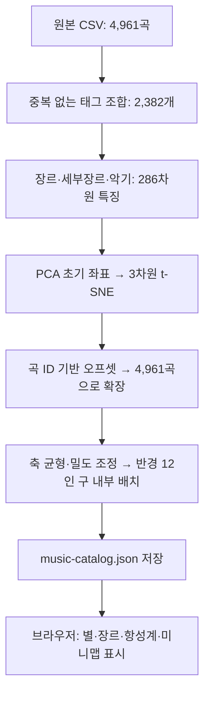

# 데이터·t-SNE·탐색 로직

[README로 돌아가기](../README.md)

이 문서는 현재 코드와 배포용 카탈로그를 기준으로 작성했습니다. 데이터 준비는 [prepare_data.py](../frontend/scripts/prepare_data.py), 브라우저의 모델은 [catalog.ts](../frontend/src/domain/catalog.ts)가 담당합니다.

## 1. 전체 흐름



- **t-SNE 계산:** 태그가 비슷한 프로필의 이웃 관계를 3차원으로 표현합니다.
- **구형 후처리:** 빈 영역을 줄이고 둥근 음악 우주를 만드는 표시용 변환입니다.
- **화면 조작:** 저장된 좌표를 읽어 카메라·색·밝기·라벨을 바꿉니다. 브라우저에서 t-SNE를 다시 계산하지 않습니다.
- 장르 분류는 CSV에 있는 값을 사용합니다. K-means나 DBSCAN으로 장르를 새로 찾는 구조는 아닙니다.

## 2. 입력 데이터와 전처리

원본은 루트의 [mtg_jamendo_genre_instrument.csv](../mtg_jamendo_genre_instrument.csv)입니다. 전처리 과정에서 원본을 수정하거나 이동하지 않습니다.

| 항목 | 현재 값 | 처리 |
| --- | --- | --- |
| 곡 | 4,961개 | `TRACK_ID`를 문자열로 보존; 앞자리 0 유지 |
| 대장르 | 15개 | `/`가 들어간 이름도 하나의 장르 |
| 세부장르 | 146개 | `\|`로 분리, 앞뒤 공백·중복 제거, 정렬 |
| 악기 | 125개 | 세부장르와 같은 태그 정리 적용 |
| 프로필 | 2,382개 | `(대장르, 정렬된 세부장르 목록, 정렬된 악기 목록)`의 고유 조합 |
| 특징 차원 | 286개 | 대장르 15 + 세부장르 146 + 악기 125 |

- 같은 장르·세부장르여도 악기 조합이 다르면 별도 프로필입니다.
- 같은 프로필은 t-SNE 입력에 한 번만 들어갑니다. 해당 프로필에 곡이 많다고 입력 행을 반복하거나 빈도 가중치를 주지는 않습니다.
- 곡명·아티스트·재생시간·MP3 경로는 메타데이터로 보존하며 특징 벡터에 넣지 않습니다.
- 실제 오디오, BPM, 음량, 주파수 특징은 입력에 없습니다.

## 3. 특징 벡터와 가중치

구현: [profile_features()](../frontend/scripts/prepare_data.py).

| 특징 묶음 | 표현 | cosine 유사도 기여 비중 |
| --- | --- | --- |
| 대장르 | one-hot | 0.15 |
| 세부장르 | multi-hot | 0.30 |
| 악기 | multi-hot | 0.55 |

한 묶음의 가중치가 `w`이고 활성 태그가 `k`개이면, 활성 항목마다 다음 값을 넣습니다. 비활성 항목은 0입니다.

```text
활성 태그 값 = sqrt(w / k)
```

- 각 묶음의 L2 norm은 `sqrt(w)`가 됩니다.
- 세 묶음을 이어 붙이면 현재 데이터에서 벡터 전체의 L2 norm은 1입니다.
- 태그가 많아져도 해당 묶음의 전체 비중은 늘어나지 않습니다.
- 15%·30%·55%는 코드에 정한 설계 값입니다. 사용자 행동에서 학습하거나 최적값을 추정한 결과는 아닙니다.

두 프로필의 대장르를 `G`, 세부장르 집합을 `S`, 악기 집합을 `I`라고 하면 입력 특징의 유사도를 다음처럼 읽을 수 있습니다.

```text
similarity(a, b)
  = 0.15 × [G_a와 G_b가 같으면 1, 다르면 0]
  + 0.30 × |S_a ∩ S_b| / sqrt(|S_a| × |S_b|)
  + 0.55 × |I_a ∩ I_b| / sqrt(|I_a| × |I_b|)

cosine distance = 1 - similarity
```

예를 들어 `Electronic / House / Piano`와 `Pop / Indie Pop / Piano`라는 가상 프로필은 장르·세부장르가 달라도 악기를 공유하므로 유사도가 `0.55`입니다. 같은 입력에서 두 번째 프로필의 악기를 `Guitar`로 바꾸면 유사도는 `0`이 됩니다.

이 비중은 **t-SNE 입력 특징의 유사도**에 적용됩니다. 최종 화면에서 거리가 이 비율대로 표현된다는 뜻은 아닙니다.

## 4. t-SNE의 실제 실행 설정

사용 라이브러리는 [requirements.txt](../frontend/scripts/requirements.txt)에 지정된 `numpy==2.2.6`, `scikit-learn==1.7.2`입니다. 구형 후처리에는 scikit-learn의 의존성으로 설치되는 SciPy도 사용합니다.

먼저 286차원 특징에서 PCA 초기 좌표를 직접 만듭니다.

```python
initial = PCA(n_components=3, svd_solver="full").fit_transform(feature).astype(np.float32)
initial *= 1e-4 / initial[:, 0].std()

xyz = TSNE(
    n_components=3,
    metric="cosine",
    perplexity=40,
    random_state=42,
    init=initial,
    learning_rate="auto",
    max_iter=1000,
    n_jobs=1,
).fit_transform(feature)
```

| 설정 | 현재 값 | 의미 |
| --- | --- | --- |
| 입력 행렬 | `2382 × 286` | 곡 전체가 아닌 고유 태그 프로필 |
| 출력 차원 | `3` | X·Y·Z 좌표 |
| 거리 | `cosine` | 정규화한 태그 특징을 비교 |
| perplexity | `40` | 이웃 관계를 계산하는 범위에 영향을 주는 값; 군집 개수는 아님 |
| 초기화 | 직접 만든 PCA 배열 | 첫 번째 축의 표준편차가 `1e-4`가 되도록 배열 전체를 같은 배율로 축소 |
| 난수 시드 | `42` | `random_state` |
| 학습률 | `auto` | 현재 입력에서는 `50` |
| 최대 반복 | `1000` | 조기 종료될 수 있으므로 항상 정확히 1,000회 실행되는 것은 아님 |
| `n_jobs` | `1` | 코드에서 명시한 이웃 계산 설정 |

나머지는 scikit-learn 1.7.2의 기본값입니다. 주요 값은 `method="barnes_hut"`, `angle=0.5`, `early_exaggeration=12.0`, `n_iter_without_progress=300`, `min_grad_norm=1e-7`입니다. `auto` 학습률은 `max(N / early_exaggeration / 4, 50)`이므로 현재 `N=2382`에서 50입니다. [공식 TSNE 문서](https://scikit-learn.org/1.7/modules/generated/sklearn.manifold.TSNE.html)

## 5. t-SNE 좌표를 둥근 우주로 바꾸는 과정

구현: [build()와 spherical_layout()](../frontend/scripts/prepare_data.py).

### 5.1 곡별 좌표로 확장

- 각 곡은 자신의 프로필에 해당하는 t-SNE 좌표를 가져옵니다.
- `random.Random(int(TRACK_ID))`로 곡별 난수를 고정합니다.
- X·Y·Z 각각에 `[-0.35, 0.35]`의 작은 오프셋을 더해 같은 프로필의 곡들을 분리합니다.
- 이 오프셋은 **구형 변환 전 좌표의 단위**이며, 최종 화면에서 반경 0.35를 보장하는 값은 아닙니다.

### 5.2 축 균형과 첫 반경 배치

1. 4,961개 점의 평균을 빼 중심을 맞춥니다.
2. 공분산 행렬을 고유분해하고 whitening 변환으로 세 축의 분산을 균형 있게 조정합니다. 고유값의 하한은 `1e-8`입니다.
3. 원점에서의 거리 순위를 구의 부피에 맞는 반경으로 바꿉니다.

```text
r = 12 × ((rank + 0.5) / N)^(1/3)

rank: 0부터 시작하는 거리 순위
N: 4,961곡
```

모든 점을 같은 반경의 껍데기에 붙이지 않고 구 내부를 채웁니다.

### 5.3 빈 영역을 줄이는 밀도 조정

- `Halton(3, scramble=True, seed=42)`으로 구 내부를 채우는 기준 분포를 만듭니다.
- `np.random.default_rng(42)`로 192개 방향을 생성하고 각 방향을 단위 벡터로 정규화합니다.
- 각 방향에서 실제 점과 기준 점의 투영값을 각각 정렬합니다.
- 같은 순위의 투영값 차이에 `0.6`을 곱해 실제 점을 그 방향으로 이동합니다.
- 192개 방향을 처리한 뒤 거리 순위에 위 반경 공식을 다시 적용합니다.

기준 분포는 배치를 조정하는 데만 사용합니다. 음악 데이터나 추가 별로 저장하지 않으며, 최종 곡의 점은 계속 4,961개입니다.

### 5.4 저장과 그룹 중심

- 최종 곡 좌표는 소수점 5자리로 반올림합니다.
- 대장르·세부장르의 기준점은 소속 곡의 최종 X·Y·Z 평균입니다.
- 여러 세부장르에 속하는 곡은 각 세부장르의 평균 계산에 포함됩니다.
- [music-catalog.json](../frontend/public/data/music-catalog.json)에는 최종 구형 좌표만 저장합니다. 후처리 전 t-SNE 좌표는 별도로 저장하지 않습니다.
- 브라우저의 [spacePosition()](../frontend/src/scene/space.ts)는 저장된 XYZ를 그대로 사용합니다. 장르 ID에 따른 임의 Z축을 추가하지 않습니다.

**해석 범위:** t-SNE는 전체 거리 보존을 보장하지 않고, 구형 후처리도 거리·밀도·방향을 바꿉니다. 가까운 별은 태그 관계를 살펴보는 단서이며, 화면의 간격을 실제 음향 차이의 측정값으로 읽으면 안 됩니다. [공식 manifold 설명](https://scikit-learn.org/1.7/modules/manifold.html#t-sne)

## 6. 선·별빛·호버의 의미

### 고정 연결선

생성 기준은 [prepare_data.py](../frontend/scripts/prepare_data.py), 표시는 [ConstellationLinks](../frontend/src/scene/ParticleField.tsx)가 담당합니다.

- 최종 구형 좌표에서 곡마다 주변 10개 이웃을 후보로 조회합니다.
- 후보 중 아래 조건을 모두 만족하는 쌍을 남깁니다.
  - 최종 좌표의 거리: `0.6 < 거리 < 2.8`.
  - 입력 특징 벡터의 유사도: `similarity > 0.65`.
  - 공통 악기가 하나 이상 있음.
- 유사도 내림차순으로 선택하며, 한 곡은 최대 한 연결선에만 사용합니다.
- 선택된 선들의 중점 사이 거리가 `1.8` 미만이면 건너뛰어 특정 위치에 선이 몰리지 않게 합니다.
- 최대 40쌍을 저장합니다. 현재 카탈로그에는 40쌍이 있습니다.

이 선은 전체 유사도 그래프나 음악 장르 사이의 확정 관계가 아니라, 조건을 만족하는 일부 곡 쌍의 표시입니다. 배경에서 움직이는 짧은 꼬리별은 장식이고, 이름과 기준점을 잇는 선은 라벨 위치 안내입니다.

### 별빛과 실제 곡 선택

구현: [ParticleField](../frontend/src/scene/ParticleField.tsx), [hoveredGenre()](../frontend/src/scene/hover.ts), [Scene](../frontend/src/scene/Scene.tsx).

- 별 하나는 실제 곡 하나이며, 별의 장르색은 해당 곡의 `genreId`로 결정됩니다.
- 작은 점의 가장자리를 부드럽게 감쇠하고, 곡 ID로 고정한 시드에 따라 밝기를 천천히 변화시킵니다.
- 시간 값은 매 프레임 실제 렌더링 중인 `ShaderMaterial.uniforms.uTime`에 전달합니다.
- 호버는 포인터가 움직였을 때 최대 약 80ms 간격으로 조회합니다. 광선 주변 반경 `0.32`에 들어오는 실제 별들의 장르를 투표합니다.
- 홈의 별 클릭도 같은 반경을 사용하고, 현재 강조된 장르를 반영해 투표합니다. 이름 위로 이동하지 않아도 호버한 별 주변을 클릭해 해당 장르로 들어갈 수 있습니다. 드래그와 이동 중 클릭은 제외합니다.
- 포인터 광선에 가깝고 카메라 앞쪽에 있는 별에 더 높은 가중치를 줍니다. 현재 장르의 점수가 최고 점수의 80% 이상이면 선택을 유지합니다.
- 강조 시작은 약 100ms, 해제는 약 240ms의 지연을 두고 색을 부드럽게 전환합니다.
- 해당 장르의 곡만 색이 활성화되며, 홈의 이름은 호버·키보드 포커스 시에만 표시됩니다.
- 강조된 별은 중심 크기를 유지하면서 주변 광채 범위를 최대 3.5배로 넓히고, 어두워지는 정도를 줄여 장르색을 더 잘 드러냅니다. 광채는 실제 소속 별마다 적용하는 표시 효과이며, 별을 추가하거나 별 사이에 새로운 관계를 만들지 않습니다.
- 홈은 천천히 자동 회전하고 호버 중에는 멈춥니다. 모션 감소 설정에서는 자동 회전과 밝기 애니메이션을 끕니다.

## 7. 방문 누적과 표시 변화

구현: [reducer.ts](../frontend/src/state/reducer.ts), [visits.ts](../frontend/src/domain/visits.ts), [VisitPanel](../frontend/src/components/VisitPanel.tsx).

| 상태 | 역할 |
| --- | --- |
| `transition` / `arrivedTransition` | 현재 이동과 완료된 이동의 번호; 취소·중복 도착 방지 |
| `arrivedGenreId` | 마지막으로 실제 도착한 장르; 같은 장르 안의 중복 집계 방지 |
| `genreVisits` | 대장르별 방문 누적 |
| `visits` / `history` | 세부장르별 방문 수와 도착 순서; 미니맵 경로에 사용 |

- 다른 장르나 전체 지도에서 해당 장르에 **실제 도착했을 때** 대장르 방문을 1회 추가합니다.
- 추천으로 세부장르에 바로 들어가도 부모 장르 방문을 기록합니다.
- 같은 장르 안의 세부장르 이동과 부모 화면 복귀는 대장르 방문을 추가하지 않습니다.
- 곡 선택·호버·취소된 이동·같은 완료 이벤트의 재호출도 추가하지 않습니다.

```text
누적 색 비중 = min(대장르 방문 수, 5) / 5
누적 밝기 배수 = 1 + min(대장르 방문 수, 10) × 0.12
최종 색 비중 = max(호버 강조 비중, 누적 색 비중)
```

- 1회: 색 20%, 밝기 계수 1.12배.
- 5회: 호버와 같은 장르색 완성, 밝기 계수 1.6배.
- 10회 이상: 같은 장르색 유지, 밝기 계수 최대 2.2배.
- 방문 횟수 자체에는 상한을 두지 않습니다.
- 밝기 배수는 반짝임과 함께 사용하는 표시 계수입니다. 매 순간의 픽셀 밝기가 정확히 그 배수가 된다는 뜻은 아닙니다.
- 방문으로 좌표나 별 크기를 바꾸지 않습니다. 표시 계수만 갱신하므로 별 geometry를 재생성하지 않습니다.
- 현재 기록은 메모리에 유지합니다. 발표·탐색 전환 시 유지되고 새로고침하면 초기화됩니다.

### 방문 기록 그래프

- `genreVisits > 0`인 장르와 `visits > 0`인 세부장르만 방문 기록 패널에 표시합니다. 각각 횟수 내림차순, 동점은 이름순입니다.
- 장르의 막대 비중은 `해당 genreVisits / 전체 genreVisits 합계`입니다.
- 세부장르의 막대 비중은 `해당 visits / 같은 부모 장르에 속한 visits 합계`입니다. 대장르 진입과 그 안의 세부장르 탐색은 별도 집계하므로 두 분모를 섞지 않습니다.
- 방문한 세부장르가 없는 장르는 하위 목록을 생략합니다. 기록이 전혀 없으면 짧은 빈 상태만 표시합니다.
- 상단에는 전체 영역의 탐색률과 격자 차트를 하나 표시합니다. 탐색률은 `(방문한 대장르 수 + 방문한 세부장르 수) / (전체 대장르 수 + 전체 세부장르 수) × 100`이며 현재 분모는 `15 + 146 = 161`입니다. 같은 영역을 다시 방문해도 탐색률은 증가하지 않습니다.
- 격자는 영역마다 한 칸이며, 방문한 칸만 부모 장르색으로 채웁니다. 아래 상세 목록에는 이름·횟수·비율·막대만 표시합니다. 세부장르 개수·집계 기준·초기화 안내 등의 설명은 이 문서에서 관리합니다.
- 색 누적은 회색 별이 고유 장르색으로 물드는 비중(`colorMix`), 밝기 누적은 별빛 세기 배수(`brightness`)입니다. 색·밝기 누적 수치는 방문 기록 패널에서 표시하지 않습니다. 실제 별의 색·밝기 누적 계산과 새로고침 시 초기화하는 정책은 유지합니다.

## 8. 추천·항성계·음악 막대

### 태그 일치 추천

구현: [recommendations.ts](../frontend/src/domain/recommendations.ts).

1. `weight > 0`이고 해당 장르에 실제로 있는 악기를 선택한 조합만 남깁니다.
2. 유효한 조합들의 비중 합으로 각 비중을 나눕니다.
3. 같은 대장르의 세부장르 후보에 대해 아래 값을 합산합니다.

```text
score(세부장르)
  = Σ (유효 조합의 정규화 비중 × 해당 세부장르에서 그 악기를 포함한 곡의 비율)
```

4. 양수 점수만 남겨 내림차순 정렬합니다. 동점은 세부장르 이름순입니다.
5. 대장르별 최고 후보 하나씩만 남겨 최대 3개 장르를 제안합니다.

- 초기 조합은 Jazz×Piano 50, Pop×Piano 30, Rock×Guitar 20입니다.
- 유효 조합이 없거나 합이 0이면 추천 결과는 비어 있습니다.
- 추천은 브라우저의 태그 일치 데모입니다. 방문 기록으로 취향을 학습하지 않습니다.
- 추천 비중을 바꿔도 지도 좌표나 t-SNE의 15%·30%·55% 가중치는 바뀌지 않습니다.

### 세부장르 줌과 시각화 신호

- 오른쪽 고정 플레이리스트는 세부장르에서만 표시하며, 해당 영역의 전체 `trackIds`를 ID 순으로 나열합니다. 세부장르 도착 후 [systemTracks()](../frontend/src/domain/catalog.ts)가 ID 순으로 고른 세 곡을 표시용 궤도에 올립니다. 추천 점수로 고른 대표곡은 아닙니다. 선택한 곡이 세 곡 밖에 있으면 첫 번째 자리를 그 곡으로 바꿉니다.
- 장르 화면의 별은 부모 장르색을 연하게 섞습니다. [hoveredSubgenre()](../frontend/src/scene/hover.ts)는 현재 대장르의 실제 별만 투표하고, 여러 세부장르 태그를 가진 별의 표는 소속 수로 나눕니다. 현재 선택을 유지하는 80% 기준은 대장르 호버와 같습니다.
- 호버·선택한 세부장르의 `trackIds`로 기존 geometry의 `aRegion` 마스크를 갱신합니다. 이 별들만 진한 부모 장르색과 광채로 강조합니다. 별 개수·좌표·geometry를 새로 만들지 않습니다.
- 장르→세부장르에서는 기존 지도를 유지하며 오른쪽 패널을 엽니다. 장르로 복귀하면 고정 패널을 숨깁니다. [frameSpace()](../frontend/src/scene/space.ts)가 실제 소속 곡이 전체 들어오는 거리를 계산하고, 세부장르 근접 거리는 그 거리의 65%(최소 3)로 정합니다. 가장자리 곡은 화면 밖에 있을 수 있습니다.
- 같은 대장르 안의 진입·복귀는 현재 카메라 시선 방향을 유지하면서 위치와 중심을 보간합니다. 원본 곡 좌표와 화각 45도는 유지하고, 세부장르의 평균 좌표를 중심으로 접근합니다. 기존 내부 상태 이름 `system`은 세부장르 줌 단계를 가리킵니다.
- 도착한 뒤 [MusicSystem](../frontend/src/scene/MusicSystem.tsx)이 세 곡의 궤도와 별빛을 겹쳐 표시합니다. [trackOrbitPosition()](../frontend/src/scene/orbits.ts)을 점과 이름이 함께 사용하여 공전 위치를 맞춥니다. 궤도 반경은 기본 `1.25 + index × 0.76`, 각속도는 `0.055 − index × 0.01` rad/s이며 작은 화면과 가까운 시점에 맞춰 전체 반경을 축소합니다. 원래 지도에서는 이 세 곡만 마스크로 숨겨 중복 표시를 막습니다.
- 공전은 곡 ID 시드로 고정한 표시용 연출이며 음악적 거리나 재생 상태를 뜻하지 않습니다. 모션 감소 설정에서는 공전을 멈추며, 곡 선택·줌·뒤로가기는 유지합니다.
- 음악 막대는 [createDemoSignal()](../frontend/src/domain/visualization.ts)이 곡 ID로 만든 40개 무음 신호 값입니다.
- CSV의 MP3 경로는 재생 URL로 사용하지 않습니다. 실제 음원 재생과 `AnalyserNode` 연결은 향후 작업입니다.
- 배경 앰비언트는 [ambient.ts](../frontend/src/audio/ambient.ts)의 Web Audio 합성이며, 선택한 곡의 실제 소리와는 별개입니다.

## 9. 재생성·검증·변경 시 확인할 것

### 데이터 재생성

루트에서 실행합니다. Python 3.11–3.13과 원본 CSV가 필요합니다.

```sh
cd frontend
python3 -m venv .venv
source .venv/bin/activate
python -m pip install -r scripts/requirements.txt
npm run data:prepare
npm run data:test
npm run data:check
```

- `data:prepare`: t-SNE·후처리를 실행하고 카탈로그 JSON을 덮어씁니다.
- `data:test`: 특징 정규화·악기 공유의 영향·구 내부 분포의 결정성을 확인합니다.
- `data:check`: 표준 라이브러리만으로 ID·개수·그룹 연결·구의 경계·중심·원본 SHA-256 등을 검증합니다. t-SNE를 다시 계산하지는 않습니다.
- 고정 시드는 같은 환경에서의 재현을 돕습니다. 라이브러리·수치 연산 환경이 바뀌어도 좌표가 비트 단위로 같다고 보장하지 않습니다. 실제 웹은 저장소에 포함된 JSON을 읽습니다.

### 프런트엔드 검증

`frontend`에서 실행합니다.

```sh
npm run typecheck
npm test
npm run build
```

### 로직 변경 체크리스트

- [ ] 태그 묶음·가중치·t-SNE 파라미터를 바꾸면 데이터 재생성 및 이 문서 갱신.
- [ ] CSV를 교체하면 예상 개수 검증과 카탈로그를 함께 갱신.
- [ ] 후처리를 바꾸면 구의 경계·이웃의 태그 관계·장르 중심·미니맵 좌표 확인.
- [ ] 방문 규칙을 바꾸면 중복 도착·취소·직접 추천·같은 장르 안의 이동 테스트 확인.
- [ ] 별빛·호버를 바꾸면 실제 셰이더 값과 시간차 화면을 확인; 이름과 색이 실제 곡의 장르에 맞는지 확인.
- [ ] 미구현 기능을 추가하면 [README의 구현 현황과 다음 작업](../README.md#구현-현황과-다음-작업) 체크리스트 갱신.
